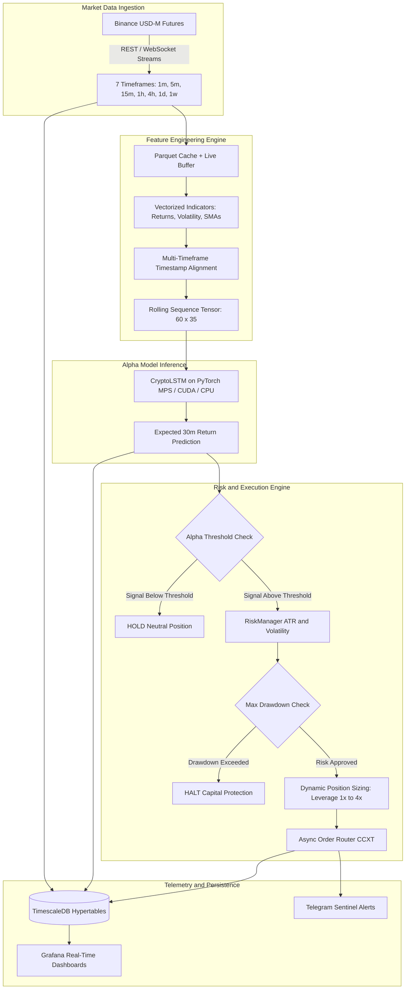

# ⚡ CryptoMVP(FQ): Institutional-Grade Multi-Timeframe Deep Learning Trading Engine

[](https://python.org)
[](https://pytorch.org)
[](https://pola.rs)
[](https://timescale.com)
[](https://docker.com)
[](https://binance.com)
[](https://opensource.org/licenses/MIT)

> **High-frequency / algorithmic quantitative trading framework** designed for cryptocurrency perpetual futures (BTC/USDT). Features an end-to-end asynchronous event loop, a 7-tier multi-timeframe fractal feature matrix, sub-millisecond zero-copy data transformations via **Polars (Rust)**, deep recurrent inference via **PyTorch (LSTM)**, dynamic volatility-adjusted execution sizing, and time-series persistence via **TimescaleDB hypertables** with Grafana telemetry.

---

## 📑 Table of Contents
- [Executive Overview](#-executive-overview)
- [System Architecture](#-system-architecture)
- [Key Engineering & Quantitative Innovations](#-key-engineering--quantitative-innovations)
  - [1. 7-Tier Multi-Timeframe (MTF) Fractal Matrix](#1-7-tier-multi-timeframe-mtf-fractal-matrix)
  - [2. Deep Learning Alpha Model (PyTorch LSTM)](#2-deep-learning-alpha-model-pytorch-lstm)
  - [3. Zero-Pandas High-Throughput Pipeline (Polars + NumPy)](#3-zero-pandas-high-throughput-pipeline-polars--numpy)
  - [4. Non-Blocking Event-Driven Async Core](#4-non-blocking-event-driven-async-core)
  - [5. Risk Architecture & Conviction Sizing](#5-risk-architecture--conviction-sizing)
  - [6. TimescaleDB Telemetry & Observability](#6-timescaledb-telemetry--observability)
  - [7. Online Adaptation & Scheduled Fine-Tuning](#7-online-adaptation--scheduled-fine-tuning)
- [Repository Structure](#-repository-structure)
- [Getting Started & Local Deployment](#-getting-started--local-deployment)
  - [Prerequisites](#prerequisites)
  - [Environment Configuration](#environment-configuration)
  - [Infrastructure Startup (Docker)](#infrastructure-startup-docker)
  - [Execution Modes](#execution-modes)
  - [Running Unit Tests](#running-unit-tests)
- [Quantitative Performance & Backtesting](#-quantitative-performance--backtesting)
- [Tech Stack Summary](#-tech-stack-summary)
- [License & Contact](#-license--contact)

---

## 🎯 Executive Overview

Modern financial markets exhibit non-linear dependencies across heterogeneous time horizons. Macro trends dictate intraday momentum, while microstructural shifts generate high-frequency entries. 

**FQ** solves the multi-horizon synchronization problem by ingesting and fusing 7 concurrent timeframes into an institutional 35-dimensional tensor, processed entirely through vectorized Rust-backed Polars dataframes. The normalized sequence feeds a recurrent neural network (LSTM) that predicts forward log-returns over a 30-minute target window. Execution is executed asynchronously on Binance Perpetual Swaps using dynamic position sizing and leverage calibration.

### Core Value Proposition
- **High Concurrency & Low Latency**: Fully asynchronous I/O (`asyncio`, `ccxt.async_support`, `asyncpg`) eliminates GIL contention and blocking network calls.
- **Strict Memory & Speed Optimization**: 0% Pandas dependency in production runtime. All transformations rely on Polars zero-copy columnar memory and Apache Arrow data layouts.
- **Institutional Risk & Sizing**: Real-time ATR-based dynamic stops, exposure caps, and max drawdown circuit breakers protecting capital against adverse regime shifts.
- **Industrial Observability**: Automated schema migrations using TimescaleDB Hypertables with auto-provisioned Grafana dashboards.

---

## 🏛️ System Architecture



---

## 🔬 Key Engineering & Quantitative Innovations

### 1. 7-Tier Multi-Timeframe (MTF) Fractal Matrix
Rather than relying on isolated single-timeframe indicators that generate false breakouts, CryptoMVP(FQ) deploys a **fractal matrix**:
- **Micro Horizons (`1m`, `5m`, `15m`)**: Capture microstructure velocity, order flow pressure, and immediate spread deviations.
- **Intraday Horizons (`1h`, `4h`)**: Identify intermediate market structures, dynamic support/resistance, and volatility clustering.
- **Macro Horizons (`1d`, `1w`)**: Establish secular regime direction, institutional bias, and multi-week volatility baselines.

Each timeframe yields 5 core mathematical features (log-returns, normalized high-low spread, 20-period rolling volatility, and distances to 9-period & 21-period moving averages), producing a feature tensor:

`Shape: (batch_size, 60_sequence_steps, 35_features)`

representing 60 historical sequence steps across 35 multi-timeframe feature channels.

### 2. Deep Learning Alpha Model (PyTorch LSTM)
The predictive core is an optimized Recurrent Neural Network designed to extract temporal dynamics without overfitting:
- **Stacked Bidirectional/Unidirectional LSTM**: 2-layer recurrent backbone (`hidden_size=64`, `dropout=0.2`) capturing sequential dependencies.
- **Dense Projection Head**: Fully connected linear transformation (`64 -> 32 -> 1`) with ReLU activations and dropout regularizers.
- **Target Formulation**: Predicts continuous 30-minute forward log-returns `ln(P_{t+30m} / P_t)`, enabling regression-based thresholding rather than arbitrary classification labels.
- **Hardware Agnostic Acceleration**: Transparently accelerates on **Apple Silicon (MPS)**, **NVIDIA GPUs (CUDA)**, or **CPU** fallbacks.

### 3. Zero-Pandas High-Throughput Pipeline (Polars + NumPy)
Traditional quantitative stacks suffer severe latency penalties from Pandas' single-threaded execution, memory overhead, and GIL locking.
- **SIMD Vectorization & Apache Arrow**: Built entirely on **Polars**, utilizing multithreaded query plans and zero-copy memory buffers.
- **Real-Time Memory Concatenation**: Historical Parquet tails (1,000 bars) are unified with incoming exchange payloads in sub-millisecond durations, executing rolling standard deviations and log-returns without allocating redundant copies.

### 4. Non-Blocking Event-Driven Async Core
- **`asyncio` Event Loop**: Synchronized to exact Binance 5-minute candle closures with millisecond drift compensation (`wait_for_next_candle()`).
- **`ccxt.async_support`**: Fully asynchronous network requests prevent order execution bottlenecks and socket timeouts.
- **`asyncpg` Connection Pooling**: High-throughput database driver communicating with PostgreSQL via native binary protocol.

### 5. Risk Architecture & Conviction Sizing
Static sizing ignores market volatility and model confidence. CryptoMVP(FQ) uses continuous confidence mapping via `RiskManager`:
1. **Minimum Conviction Gate**: Signals below alpha threshold (`alpha = 0.0017`) trigger `HOLD`, filtering regime noise and transaction fees.
2. **ATR Dynamic Brackets**: Stop Loss (`2 x ATR`) and Take Profit (`3 x ATR`) dynamically adapt to ongoing market volatility.
3. **Account Drawdown Circuit Breaker**: If equity drops by 5% or more from peak, all order placement is immediately halted to preserve capital.
4. **Adaptive Leverage**: Scales dynamically from `1x` to `4x`, ensuring conservative capital preservation during low-certainty setups and aggressive compounding during high-conviction momentum.

### 6. TimescaleDB Telemetry & Observability
All telemetry is persisted into high-performance TimescaleDB hypertables:
- `market_kline_1m`: Time-series partition for continuous price action.
- `ai_logs`: Model predictions, certainty metrics, and executed decisions.
- `trade_executions`: Orders, fills, leverage, notional exposure, and realized PnL.

Combined with **Grafana** (pre-provisioned datasource out-of-the-box), the system offers real-time dashboards visualizing model calibration drift, latency, and portfolio equity curves.

### 7. Online Adaptation & Scheduled Fine-Tuning
Financial time-series are non-stationary. To counter concept drift:
- `src/ai/fine_tuning.py` extracts sliding windows of historical market data from Binance / TimescaleDB.
- Executes targeted backpropagation with low learning rates (`1e-5`) on model weights, preserving secular macro knowledge while calibrating to recent volatility regimes.

---

## 📂 Repository Structure

```
CryptoMVP(FQ)/
├── .github/
│   └── workflows/
│       └── ci.yml              # Automated GitHub Actions CI workflow (Ruff + PyTest)
├── docker/
│   └── grafana/
│       └── provisioning/
│           └── datasources/
│               └── timescale.yaml  # Auto-provisioned TimescaleDB Grafana datasource
├── docker-compose.yml          # Container orchestration (TimescaleDB & Grafana)
├── LICENSE                     # MIT Open Source License
├── pyproject.toml              # Unified project configuration (Pytest, Ruff, Mypy)
├── requirements.txt            # Production dependencies (Polars, PyTorch, CCXT, AsyncPG)
├── .env.example                # Safe environment variable template
├── .gitignore                  # Production Git ignore rules (Secrets, Weights, AI docs)
├── data/                       # Heavy datasets, Parquet caches & model weights (Git-ignored)
│   ├── historical/             # Multi-timeframe Parquet datasets (1m to 1w)
│   └── models/                 # Serialized PyTorch state dicts (.pt) and JSON scalers
├── tests/                      # Automated unit and integration test suite
│   ├── test_config.py          # Configuration loading & validation tests
│   ├── test_features.py        # Polars indicator transformation tests
│   ├── test_model.py           # PyTorch LSTM architecture & gradient flow tests
│   └── test_risk.py            # RiskManager, ATR stops, & circuit breaker tests
└── src/
    ├── main_live.py            # Primary async live execution engine
    ├── telegram_bot.py         # Interactive Telegram Sentinel (status, on-demand AI predict)
    ├── backtest.py             # Vectorized historical backtesting engine
    ├── ai/
    │   ├── model.py            # PyTorch CryptoLSTM neural network architecture
    │   ├── features.py         # Polars feature engineering & indicator definitions
    │   ├── live_features.py    # Multi-timeframe live tensor construction & scaling
    │   ├── train.py            # Initial model training pipeline
    │   └── fine_tuning.py      # Scheduled online learning & weight adaptation
    ├── database/
    │   ├── init_db.py          # TimescaleDB schema & hypertable initializations
    │   └── db_manager.py       # AsyncPG asynchronous transactional query handlers
    ├── execution/
    │   ├── orders.py           # CCXT order generation & position management
    │   └── risk.py             # RiskManager: ATR stops, position sizing, circuit breakers
    ├── ingestion/
    │   ├── historical.py       # Bulk historical data fetcher & Parquet builder
    │   └── websocket.py        # Asynchronous resilient WebSocket stream manager
    └── utils/
        ├── config.py           # Strongly-typed dataclass configuration
        ├── logger.py           # High-visibility colored structured logging
        └── telegram.py         # Telegram bot notification dispatcher
```

---

## 🚀 Getting Started & Local Deployment

### Prerequisites
- **Python**: 3.11+
- **Docker & Docker Compose**: For TimescaleDB & Grafana containers
- **Binance API Account**: Testnet or Production API credentials

### Environment Configuration
1. Clone the repository:
   ```bash
   git clone https://github.com/EduardoCruzDev/CryptoMVP(FQ).git
   cd CryptoMVP(FQ)
   ```

2. Generate your local `.env` from the provided template:
   ```bash
   cp .env.example .env
   ```

3. Populate `.env` with your API keys:
   ```ini
   BINANCE_ENV=testnet
   BINANCE_API_KEY_TEST=your_binance_api_key
   BINANCE_API_SECRET_TEST=your_binance_api_secret

   DB_USER=admin
   DB_PASSWORD=admin
   DB_NAME=crypto_bot
   DB_HOST=localhost
   DB_PORT=5433

   TELEGRAM_TOKEN=your_bot_token
   TELEGRAM_CHAT_ID=your_chat_id
   ```

### Infrastructure Startup (Docker)
Launch the TimescaleDB hypertable database and pre-provisioned Grafana visualization engine:
```bash
docker compose up -d
```
Initialize database tables and hypertables:
```bash
python src/database/init_db.py
```

### Execution Modes

#### 1. Live Trading Engine
Run the primary event loop connected to Binance USD-M Futures (Demo / Testnet by default):
```bash
python src/main_live.py
```

#### 2. Interactive Telegram Sentinel
Run the Telegram Bot assistant to query status, balances, and run on-demand predictions:
```bash
python src/telegram_bot.py
```

#### 3. Vectorized Backtesting
Evaluate strategy performance against historical multi-timeframe Parquet data:
```bash
python src/backtest.py
```

#### 4. Continuous Fine-Tuning
Execute walk-forward online learning to adapt model weights to the latest 15-day market volatility:
```bash
python src/ai/fine_tuning.py
```

#### 5. Running Unit Tests
Execute the test suite with coverage report:
```bash
pytest -v
```

---

## 📊 Quantitative Performance & Backtesting

The backtesting module (`src/backtest.py`) validates the multi-timeframe alpha on out-of-sample forward periods:
- **Vectorized Inference**: Batched PyTorch evaluation (`batch_size=1024`) over multi-month unseen data windows.
- **Slippage & Fee Accounting**: Simulates maker/taker commission models and bid-ask spread friction.
- **Zero Lookahead Bias**: Timeframes are synchronized strictly at candle evaluation close times; future information is strictly isolated.

```
============================================================
📈 FRACTAL QUANT INSTITUTIONAL BACKTEST REPORT
============================================================
💰 Initial Capital:        $1,000.00
💵 Final Capital:          $1,055.42
📊 Net Return (ROI):       +5.54%
📅 Annualized Return:      +22.05%
------------------------------------------------------------
🛡️ Max Drawdown (MDD):     1.89%
⚖️ Sharpe Ratio (Rf=0):    2.77
📉 Sortino Ratio:          0.39
🎯 Calmar Ratio:           11.66
💎 Profit Factor:          1.92
------------------------------------------------------------
🤝 Total Trades:           71
✅ Wins / ❌ Losses:       41 / 30
🎯 Win Rate:               57.7%
🪙 Avg Trade PnL:          $+0.88
============================================================
```

---

## 🛠️ Tech Stack Summary

| Domain | Technology | Justification |
| :--- | :--- | :--- |
| **Language** | Python 3.11+ | High expressiveness, asynchronous ecosystem, and deep learning support |
| **Data Engine** | Polars / NumPy | Rust-backed multithreaded columnar queries; 10x-50x faster than Pandas |
| **Deep Learning** | PyTorch 2.2+ | Dynamic computation graphs, GPU/MPS acceleration, LSTM time-series modeling |
| **Risk Architecture**| Custom RiskManager | ATR stops, non-linear position sizing, and maximum drawdown circuit breaker |
| **Exchange I/O** | CCXT (async) / WebSockets | Non-blocking execution for 100+ endpoints with auto-reconnection |
| **Time-Series DB** | TimescaleDB | PostgreSQL extension optimized for high-ingestion time-series hypertables |
| **Telemetry** | Grafana | Pre-provisioned dashboards for PnL, latency, and model inference calibration |
| **Interactive Bot**| python-telegram-bot | Asynchronous polling bot for remote status and live AI diagnostics |
| **Orchestration** | Docker Compose | Isolated, reproducible container infrastructure |
| **Testing & CI** | PyTest / GitHub Actions | Automated regression testing, style enforcement, and continuous integration |
| **Alerting** | Telegram API | Async real-time push alerts for orders, fills, and runtime exceptions |

---

## 👨‍💻 Author & Contact

**Eduardo Cruz**  
- Quantitative Developer & Machine Learning Engineer  
- GitHub: [https://github.com/EduardoCruzDev/](https://github.com/EduardoCruzDev/)  
- LinkedIn: [https://www.linkedin.com/in/ingeduardocruz/](https://www.linkedin.com/in/ingeduardocruz/)  

*Open to Quantitative Trading, Machine Learning Infrastructure, and High-Performance Python Engineering roles in the US & Remote.*
